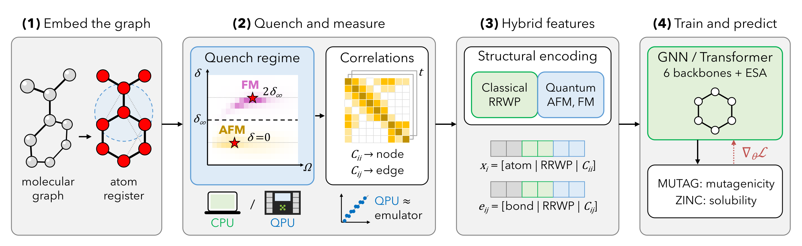

# Neutral-Atom Quantum Features as Complementary Structural Encodings for Graph Learning

[](https://arxiv.org/abs/XXXX.XXXXX)

<p align="center">
  
</p>

**Pipeline.** (1) Embed the graph in an atom register; (2) run a quench in the
antiferromagnetic (AFM) or ferromagnetic (FM) regime and measure the correlations
*C<sub>i,j</sub>*; (3) diagonal/off-diagonal elements *C<sub>i,j</sub>* serve as
node/edge features and are combined with classical RRWP; (4) train GNNs and ESA on the
combined encodings to predict molecular properties.

Code and data to reproduce the machine-learning experiments of the paper by Mathieu
Garrigues, Igor Sokolov, Matthias Hecker, Lorenzo Moro and Shaheen Acheche (Pasqal,
France), accepted at NeurIPS 2026.

**Mathieu
Garrigues & Igor Sokolov contributed equally.**

## Introduction

A graph is encoded in the geometry of a neutral-atom register (one atom per node,
neighbours at the blockade-scale distance, non-neighbours far apart). The register is
quenched under a constant global Rydberg drive in two regimes, antiferromagnetic-like
(**AFM**: `Omega = 0.3 J_NN`, `delta = 0`) and ferromagnetic-like (**FM**:
`Omega = 0.5 J_NN`, `delta = sum_{i!=j} J_ij / (2N)`). The connected occupation
correlations `C_ij(t)` measured at 20 times in [0.1, 4] us are the **quantum graph
features (QGFs)**: the diagonal gives node features, the off-diagonal pair features.

The paper (i) measures how much structural information QGFs carry with an intrinsic
benchmark of 15 graph-theoretic tasks probed by a DeepSet, (ii) bounds how much of them
classical descriptors can reconstruct, (iii) adds them to six GNN / graph-transformer
backbones on MUTAG and ZINC\*<sub>subset</sub>, and (iv) runs the full AFM pipeline on
a neutral-atom QPU for all 188 MUTAG graphs. QGFs do not replace classical encodings
such as RRWP but complement them: RRWP + QGF hybrids are the most informative feature
sets intrinsically and give small, sign-consistent downstream gains.

The whole map of paper items to commands is in [`reproduce/README.md`](reproduce/README.md);
[`reproduce/walkthrough.ipynb`](reproduce/walkthrough.ipynb) goes through the paper in order
(what each experiment shows, what to run, caveats, where the results are).
An agent skill that explains the paper and drives reproductions lives in
[`.claude/skills/qgf-paper/`](.claude/skills/qgf-paper/SKILL.md).

## Requirements

Python >= 3.11 and [uv](https://docs.astral.sh/uv/). A CUDA GPU is recommended for
the downstream and intrinsic grids (everything also runs on CPU).

```bash
uv sync                      # core: data loaders, encodings, probes, GT, reconstruction
uv sync --extra stats        # App. G statistics (baycomp, pystan; needs libstdc++ from GCC >= 11)
uv sync --extra generate     # feature generation: pulser, emu-sv, emu-mps, pasqal-cloud, qoolqit
uv sync --extra esa          # ESA (Table 4): bitsandbytes, Lightning (Linux)
uv sync --all-extras         # everything (each `uv sync` drops extras it is not given)
uv run pytest -q             # unit + smoke tests
```

**Exact reproduction.** The project environment reproduces the published numbers
statistically. To reproduce the published *trials* bit for bit (ESA, downstream GNNs,
ablations, non-unit-disk), use the pinned environment of the original runs:

```bash
uv sync --frozen --project reproduce/paper_env      # Python 3.11, torch 2.4.0+cu121, PyG 2.6.0, xformers
PYTHONPATH=src uv run --frozen --project reproduce/paper_env python experiments/<item>/run.py ...
```

on the hardware of the original runs (ESA: A100 with `--attention xformers`; GNNs and
ablations: AMD EPYC 7742 CPUs without GPU, with the per-experiment thread count). The Slurm
wrappers do this with `ESA_ENV=paper`, `GNN_ENV=paper`, `ABL_ENV=paper`; details in
[`reproduce/README.md`](reproduce/README.md).

## Data

Precomputed features (2.2 GB) and raw measurement counts (1.4 GB) are released on Zenodo,
DOI [10.5281/zenodo.23099924](https://doi.org/10.5281/zenodo.23099924) (record 23099924;
the download below works once the record is published).

```bash
uv run python -m qgf.data.download                        # -> data/processed
uv run python -m qgf.data.download --files qgf_raw.tar    # raw counts
tar xf data/processed/qgf_raw.tar -C data                                        # -> data/raw
uv run python -m qgf.data.download --files qgf_results.tar                       # reference results
uv run python -m qgf.data.download --files qgf_results_additions.tar             # exact GNN/ESA/ablation/non-unit-disk trials
tar xf data/processed/qgf_results.tar -C <dir>                                   # -> <dir>/results
uv run python -c "from qgf.data import verify; print(verify() or 'ok')"         # sha256 check
```

`data/raw`: `emulation/{mutag,zinc}/` and `qpu/mutag_afm/` (bitstring counts),
`embeddings/` (ZINC register positions), `layout_sensitivity/`; file names in
`qgf.generate.raw.raw_path`. `qgf_results.tar` (a few MB) holds the per-trial / per-cell
result files of the reference runs of every experiment (layout and commands in its
`results/README.md`); extract it outside the repository's `results/` to compare with your own runs.

```python
from qgf.data import load, load_splits

graphs, meta = load("mutag_afm")  # list of torch_geometric Data + metadata
splits, meta = load_splits("zinc_fm")  # {"train", "val", "test"}
```

Datasets: `mutag_{afm,fm}`, `mutag_hw_afm` (QPU; one-body diagonal with the single-atom
readout correction), `mutag_{afm,fm}_residual`, `ladder_{afm,fm}` (synthetic ladders),
`mutag_exact[_nn]_{afm,fm}` (exact, noise-free features of the 173 graphs with N <= 24, register
or graph-Hamiltonian couplings), `zinc_{afm,fm}[_residual]`, `zinc1500_{afm,fm}` and
`zinc_tiny_{afm,fm}` (ablations; splits). Each graph holds `x`,
`edge_index`, `edge_attr`, `y`, atom positions `pos` [N, 2] (um),
`onebody_features` [T, N] and `twobody_features` [T, N, N] (time-major; ZZ convention
`4 C`). `QGF_DATA` overrides the data root.

**New graphs.** Atom positions for MUTAG and ZINC are shipped. To embed other graphs,
use Blade from [qoolqit](https://github.com/pasqal-io/qoolqit)
(`qoolqit.embedding.Blade`); a working recipe and the emulation pipeline are in
[`experiments/generation/README.md`](experiments/generation/README.md).

## Training

```bash
# downstream graph transformer (Tables 2-3, GT column), one trial then the full grids
uv run python experiments/downstream_gt/run.py --dataset mutag --configs rrwp --folds 0 --seeds 1
uv run python experiments/downstream_gt/run.py --dataset mutag --configs paper
uv run python experiments/downstream_gt/run.py --dataset zinc  --configs paper
# intrinsic benchmark (Table 1, Tables 11-12), one cell
uv run python -m qgf.intrinsic.run --dataset MUTAG --pe_type RRWP_FM_AFM \
    --benchmark degree_prediction --output_dir results/intrinsic/grid
# feature generation for a few graphs (emulation)
uv run --extra generate python experiments/generation/run.py --dataset mutag_afm --pulse afm \
    --start 0 --end 4 --out results/generation/mutag_afm_0_4 --features
```

Slurm wrappers for the full grids are in each experiment folder.

## Evaluation

```bash
uv run python experiments/downstream_gt/analyze.py                         # Tables 2-3 (GT)
uv run python -m qgf.intrinsic.tables --results_dir results/intrinsic/grid \
    --out_dir results/intrinsic/tables                                     # Tables 1, 11, 12
uv run python experiments/reconstruction/run.py ceiling                    # classical ceiling
uv run --extra stats python -m qgf.stats.pe_benchmark --trials experiments/stats/inputs/gt_trials.csv \
    experiments/stats/inputs/other_backbones_mutag_trials.csv --output-dir results/stats   # App. G
```

## Results

| Paper item | Result | Command |
|---|---|---|
| Table 2, MUTAG GT macro-F1, RRWP / RRWP+AFM+FM | 0.854 / 0.874 | `experiments/downstream_gt/run.py --dataset mutag --configs paper` |
| Table 2, MUTAG GT, HW-AFM<sub>stat</sub> / RRWP+HW-AFM<sub>stat</sub> | 0.778 / 0.849 | same |
| Geometry table, MUTAG GT, RRWP+L+Rings+r,J / + AFM + FM | 0.8736 / 0.8818 | same |
| Table 3, ZINC\*<sub>subset</sub> GT MAE, RRWP / RRWP+AFM<sub>stat</sub> | 0.113 / 0.108 | `... --dataset zinc --configs paper` |
| Table 1, intrinsic ZINC\*<sub>subset</sub>, degree MAE (x10^2), RRWP / AFM / RRWP+FM+AFM | 14.4 / 1.26 / 1.25 | `experiments/intrinsic/submit_grid.sh` |
| Strengthened baseline, ZINC, RRWP+L+Ring+r,J / + AFM + FM, betweenness MAE | 0.020 / 0.018 (degree: tie) | same |
| Classical reconstruction ceiling, MUTAG, unexplained variance (RF, extended basis), AFM / FM | 8.3 % / 14.0 % | `experiments/reconstruction/run.py ceiling` |
| Fig. 5, QPU vs emulation per-graph Spearman (median), one-/two-body | 0.921 / 0.870 | `experiments/qpu_vs_emulation/run.py` |
| App. G, fixed-champion sign test | 10/12, p = 0.0193 | `qgf.stats.pe_benchmark` |
| Placement noise s = 0.02, feature similarity | 0.819 (stored study), 0.813 (Blade re-run) | `experiments/layout_sensitivity/run.py` |
| Fig. 4, temporal PCA, ZINC AFM two-body PC1 | 59.4 % | `experiments/temporal_pca/run.py --dataset zinc` |
| Synthetic ladders (RRWP-2-blind, pinned vs frustrated), logistic-regression ROC-AUC, RRWP+Lap+Ring+Geom / + AFM + FM | 0.680 / 0.941 | `experiments/ladder/run.py` |
| Table 2, MUTAG GCN macro-F1, RRWP / RRWP+AFM (column best) | 0.849 / 0.878 (exact re-run: identical, 5500/5500 trials) | `experiments/downstream_gnns/run.py --dataset mutag` |
| Table 3, ZINC\*<sub>subset</sub> GINE MAE, RRWP / RRWP+AFM<sub>stat</sub>+FM<sub>stat</sub> | 0.117 / 0.116 (exact re-run: identical, 450/450 trials) | `... --dataset zinc` |
| Table 4, MUTAG ESA F1, RWSE\* / gated RWSE\*+AFM+FM | 0.905 / 0.922 (re-run bit-identical, 750/750 trials) | `ESA_ENV=paper experiments/esa/submit.sh --configs paper` |
| Table 10, GAT on ZINC<sub>tiny</sub>, large, No PE / AFM (MAE) | 0.483 / 0.421 (exact re-run: 1360/1360 trials, Table 10 identical) | `experiments/ablations/run.py` |
| Fig. 6, GT capacity, ZINC\*<sub>subset</sub> MAE at D = 256, RRWP / RRWP+AFM | 0.114 / 0.111 (original) | `experiments/ablations/capacity.py run` |
| Fig. 2, toy recovery R^2 at 400 ns, K = 21 adjacency, AFM / FM | 0.811 / 0.403 | `experiments/reconstruction/fig2.py` |
| Exact non-unit-disk MUTAG (173 graphs), mean F1 over 7 GNNs, classical / + exact `J_NN A` | 0.851 / 0.852 (exact re-run: identical, 1400/1400 trials; no significant gain) | `experiments/non_unit_disk/run.py` |

Expected values and tolerances: [`reproduce/README.md`](reproduce/README.md) and the
`experiments/*/README.md` files. The physics section (exact diagonalisation, parameter
sweeps) is not part of this release yet.

## Citation

```bibtex
@inproceedings{qgf2026,
  title     = {Neutral-Atom Quantum Features as Complementary Structural Encodings for Graph Learning},
  author    = {Garrigues, Mathieu and Sokolov, Igor and Hecker, Matthias and Moro, Lorenzo and Acheche, Shaheen},
  booktitle = {Advances in Neural Information Processing Systems},
  year      = {2026}
}

@dataset{qgf2026data,
  title     = {Neutral-Atom Quantum Features as Complementary Structural Encodings for Graph Learning: datasets},
  author    = {Garrigues, Mathieu and Sokolov, Igor and Hecker, Matthias and Moro, Lorenzo and Acheche, Shaheen},
  publisher = {Zenodo},
  year      = {2026},
  doi       = {10.5281/zenodo.23099924}
}
```

## Licence

Pasqal open-source licence (MIT-derived), see [`LICENSE.md`](LICENSE.md). The Zenodo data
are released under the same licence.
